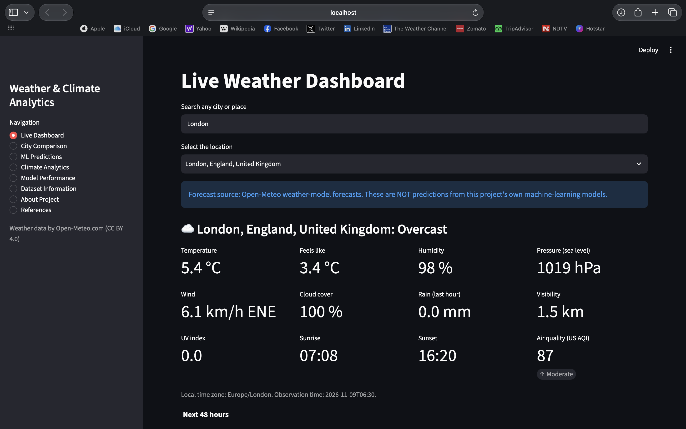
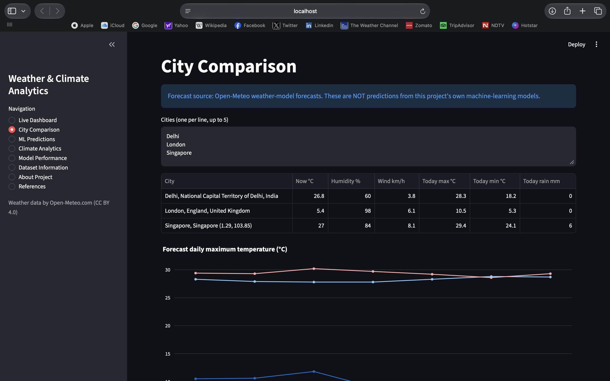
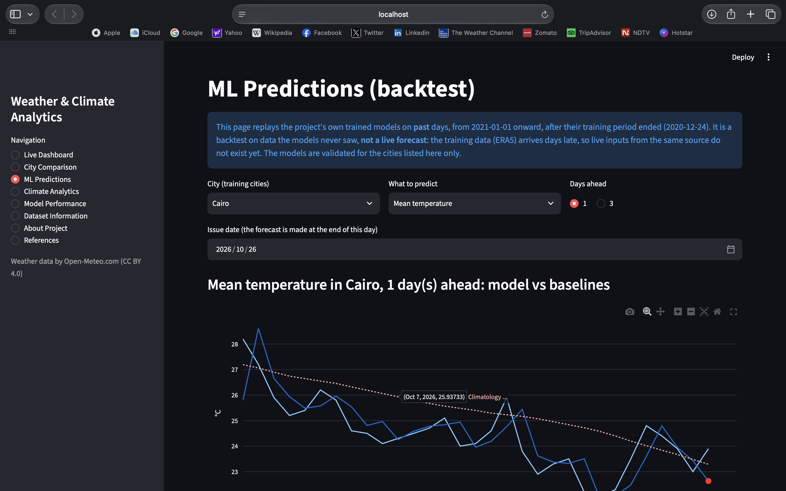
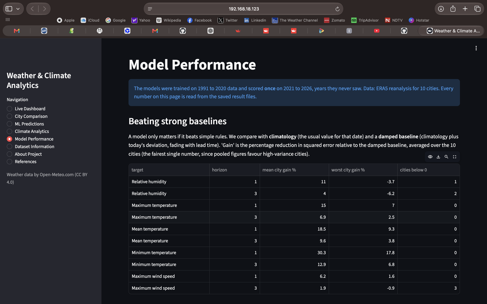
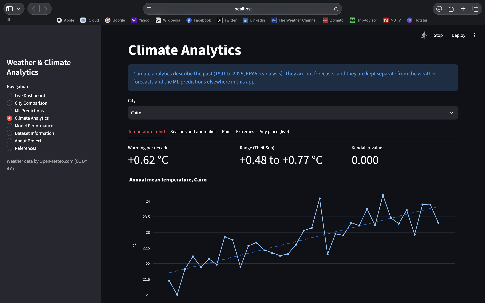

# Weather Forecasting and Climate Analytics

Machine-learning weather prediction and climate analytics on ERA5 reanalysis data, with a Streamlit dashboard.
M.Tech Data Science & Analytics project by Sundram Vaths.

**Live app:** not deployed yet

## Overview.

The project combines three things that are deliberately kept apart in the app:

1. **Live weather forecasts** from Open-Meteo (weather-model output) for any place in the world.
2. **Predictions from this project's own ML models**, trained on ERA5 history and always compared with strong baselines.
3. **Climate analytics**: long-term trends, seasons, anomalies and extremes. These describe the past and are not forecasts.

## Problem statement

Many student weather projects report a single accuracy figure with no baseline, mix forecasting with climate
description, and leak future information into training. This project asks a narrower, testable question:
**how much can machine learning improve on strong, simple forecasts (climatology and a damped persistence
baseline) when evaluated strictly on years the models never saw, and where does it fail?**

## Objectives

- Build a clean, reproducible ERA5 dataset and verify its quality before modelling.
- Forecast next-day and 3-day temperature, humidity, wind and rain, and judge every model against baselines.
- Evaluate without leakage: chronological splits with gaps, train-only statistics, and a test period used once.
- Test generalisation to cities the model has never seen.
- Deliver an honest, deployable dashboard that separates forecasts, ML predictions and climate analytics.

## Methodology

**Data.** Daily ERA5 reanalysis (Copernicus/ECMWF) through the Open-Meteo Historical API, 1991 to 2026, for
10 climatically contrasting cities. Every request pins the source to ERA5 (`models=era5`): the API's
default silently changes data source in 2017, which created a false jump in rainfall (the default data showed 55-59%
wet days in Nairobi for 2018-2020 against 38-42% in ERA5) until a source-comparison check caught it and the data was
re-downloaded.

**Splits and leakage control.** Train 1991-2017, validation 2018-2020, test 2021-2026, with 7-day gaps between
parts so that no training target can fall in a later period. Climatologies, damping factors and city weights are
fitted on training rows only. Features use only information available at the end of the issue day. Each of these
rules is covered by an automated test (for example, corrupting all future values must not change earlier features).
The final models are trained on 1991-01-01 to 2020-12-24 (train + validation) and scored once on 2021-01-01 to 2026-10 (test).

**Baselines.** Climatology (smoothed day-of-year mean), persistence, climatology plus today's anomaly, and a
**damped anomaly** baseline (the anomaly fades with lead time by a per-city fitted factor). The damped baseline is the
main bar to beat.

**Models.** Gradient boosting (scikit-learn) predicting the anomaly relative to climatology, with cities weighted by
inverse variance so that high-variance cities do not dominate training. Features: recent anomalies of nine variables,
rainfall history, pressure tendency, diurnal range and seasonality. Location features (latitude, longitude, elevation)
were dropped because they did not help on unseen cities. Rain uses a two-stage model: probability of a wet day (at least
1 mm) and a gamma-loss amount model.

**Evaluation.** MAE and RMSE, mean squared-error improvement over the damped baseline (averaged over cities), Brier
score and Brier skill for rain, and a leave-cities-out test.

## Dataset

Source: ERA5 reanalysis via the Open-Meteo Historical Weather API (CC BY 4.0, attribution: *Weather data by Open-Meteo.com*).
ERA5 is a reanalysis (a model product), not a station record. Cities used for training and evaluation:

| City | Country | Region | Latitude | Longitude |
|---|---|---|---|---|
| Delhi | India | Asia | 28.61 | 77.21 |
| Mumbai | India | Asia | 19.08 | 72.88 |
| Singapore | Singapore | Asia | 1.35 | 103.82 |
| Ulaanbaatar | Mongolia | Asia | 47.89 | 106.91 |
| London | UK | Europe | 51.51 | -0.13 |
| Cairo | Egypt | Africa | 30.04 | 31.24 |
| Nairobi | Kenya | Africa | -1.29 | 36.82 |
| New York | USA | North America | 40.71 | -74.01 |
| Sao Paulo | Brazil | South America | -23.55 | -46.63 |
| Sydney | Australia | Oceania | -33.87 | 151.21 |

Variables: daily maximum, minimum and mean temperature, precipitation, maximum wind speed, relative humidity,
surface pressure, cloud cover, dew point and shortwave radiation. Data quality checks (missing values, duplicates,
physical ranges, consistency) found no problems after the source fix.

## Results

Final models, scored **once** on 2021-01-01 to 2026-10 (test) (data the models never saw).

### Improvement over the damped baseline (mean over the 10 cities)

| target | horizon | mean city gain % | worst city gain % | cities below 0 |
|---|---|---|---|---|
| Relative humidity | 1 | 11.0 | -3.7 | 1 |
| Relative humidity | 3 | 4.0 | -6.2 | 2 |
| Maximum temperature | 1 | 15.0 | 7.0 | 0 |
| Maximum temperature | 3 | 6.9 | 2.5 | 0 |
| Mean temperature | 1 | 18.5 | 9.3 | 0 |
| Mean temperature | 3 | 9.6 | 3.8 | 0 |
| Minimum temperature | 1 | 30.3 | 17.8 | 0 |
| Minimum temperature | 3 | 12.9 | 6.8 | 0 |
| Maximum wind speed | 1 | 6.2 | 1.6 | 0 |
| Maximum wind speed | 3 | 1.9 | -0.9 | 3 |

"mean city gain" is the average percentage reduction in squared error relative to the damped baseline; "cities below 0"
counts cities where the model was worse than that baseline.

### Error in physical units (all cities pooled)

| target | horizon | MAE climatology | MAE damped baseline | MAE final model | gain over damped baseline % | skill vs climatology |
|---|---|---|---|---|---|---|
| Relative humidity | 1 | 6.981 | 4.974 | 4.649 | 14.259 | 0.527 |
| Relative humidity | 3 | 6.980 | 6.491 | 6.384 | 2.788 | 0.141 |
| Maximum temperature | 1 | 2.396 | 1.736 | 1.574 | 18.960 | 0.542 |
| Maximum temperature | 3 | 2.395 | 2.263 | 2.188 | 5.934 | 0.141 |
| Mean temperature | 1 | 1.816 | 1.153 | 1.011 | 24.641 | 0.663 |
| Mean temperature | 3 | 1.816 | 1.668 | 1.590 | 8.608 | 0.190 |
| Minimum temperature | 1 | 1.870 | 1.302 | 1.070 | 31.332 | 0.640 |
| Minimum temperature | 3 | 1.870 | 1.737 | 1.622 | 11.028 | 0.197 |
| Maximum wind speed | 1 | 3.612 | 3.191 | 3.088 | 6.778 | 0.253 |
| Maximum wind speed | 3 | 3.612 | 3.568 | 3.533 | 1.546 | 0.037 |

### 1-day mean temperature, city by city

| City | Gain over damped baseline, 1 day (%) |
|---|---|
| Ulaanbaatar | 29.2 |
| New York | 29.1 |
| Cairo | 25.0 |
| Sydney | 24.0 |
| Sao Paulo | 23.5 |
| London | 15.4 |
| Singapore | 10.3 |
| Nairobi | 10.2 |
| Delhi | 9.3 |
| Mumbai | 9.3 |

### Rain occurrence (probability of at least 1 mm)

| horizon | brier | Brier skill vs climatology |
|---|---|---|
| 1.000 | 0.124 | 0.198 |
| 3.000 | 0.150 | 0.030 |

| city | 1 day(s) ahead | 3 day(s) ahead |
|---|---|---|
| Cairo | 0.001 | -0.011 |
| Delhi | 0.239 | 0.046 |
| London | 0.173 | 0.042 |
| Mumbai | 0.405 | 0.139 |
| Nairobi | 0.244 | 0.056 |
| New York | 0.131 | -0.013 |
| Sao Paulo | 0.212 | 0.002 |
| Singapore | 0.201 | 0.059 |
| Sydney | 0.231 | 0.025 |
| Ulaanbaatar | 0.107 | 0.005 |

### Can the models handle a city they never saw?

Leave-cities-out test on the validation years: train on 9 cities, score the 10th. Average % improvement over each city's own damped baseline.

| target | horizon | city seen in training % | city held out, with location % | city held out, no location % |
|---|---|---|---|---|
| Relative humidity | 1 | 13.5 | -1.6 | -0.6 |
| Maximum temperature | 1 | 18.1 | 6.6 | 7.5 |
| Mean temperature | 1 | 21.6 | 7.1 | 9.5 |
| Mean temperature | 3 | 10.4 | 4.2 | 4.6 |
| Minimum temperature | 1 | 31.6 | 19.4 | 22.1 |
| Maximum wind speed | 1 | 7.8 | -2.1 | -1.7 |

### Key findings

- **Mean temperature, 1 day ahead:** average improvement over the damped baseline is 18.5%
  (worst city +9.3%; 0 of 10 cities worse than the baseline).
- **Mean temperature, 3 days ahead:** the average improvement is 9.6%
  (0 of 10 cities worse than the baseline).
- **Strongest and weakest 1-day targets:** Minimum temperature (30.3%) and
  Maximum wind speed (6.2%).
- **Rain and wind:** Brier skill against climatology is 0.198 at 1 day and
  0.030 at 3 days; wind at 3 days improves 1.9% over the damped baseline. Skill beyond about 1 to 2 days is essentially gone for rain and wind.
- **New cities are much harder.** For 1-day mean temperature the average gain is 21.6% for cities the model trained on and 9.5% when the city is held out of training (measured on the validation years). Whatever the gap, the ML predictions are validated for the 10 training cities only.

## Application screenshots











## Limitations

- ERA5 is a gridded reanalysis, not station observations; rainfall in particular differs from gauge data.
- The models use only a city's own recent history, so skill fades after about 3 days. For longer ranges the
  weather-model forecasts (Open-Meteo pages) are the right tool.
- Predictions are validated for the 10 training cities only. The app's ML page is a **backtest** on past days, not a
  live forecast: ERA5 arrives days late, so live inputs from the same source do not yet exist.
- Climate trend p-values assume independent years and are optimistic; hot-day, heatwave and heavy-rain definitions are
  simple city-relative thresholds, not official warning criteria.
- Design choices (city weighting, dropping location features) were made on the validation years; the test years were used once.

## Repository structure

## Installation and reproduction

```bash
python -m venv .venv && source .venv/bin/activate
pip install -r requirements-dev.txt
python -m pytest -q                         # run the tests
python scripts/00_probe_api.py              # check the API
python scripts/01_download_data.py --pilot --wait
python scripts/02_validate_data.py
python scripts/03_prepare_dataset.py
python scripts/04_run_baselines.py
python scripts/12_leave_cities_out.py
python scripts/13_train_final.py            # dry run on validation
python scripts/13_train_final.py --final --no-location   # trains the final models, scores the test years ONCE
python scripts/14_export_app_data.py
streamlit run app.py
```

No API key is needed (Open-Meteo is keyless for non-commercial use). The raw data are not stored in the repository;
the scripts regenerate them.

## Deployment

The app runs on Streamlit Community Cloud from this repository (`app.py`). `requirements.txt` is a lean, version-pinned
list: the saved models are pickles and must be loaded with the scikit-learn version they were trained with.

## Future scope

- A larger, more diverse city sample (the leave-cities-out test shows spatial transfer is the main weakness).
- Correct the Open-Meteo forecast with ML post-processing (needs the historical forecast archive) to extend skill
  beyond 3 days.
- Probabilistic temperature forecasts with calibrated intervals, and station-data validation of ERA5.
- Live ML predictions once inputs from a matching source with low latency are available.

## References

- Hersbach, H. et al. (2020). The ERA5 global reanalysis. *Quarterly Journal of the Royal Meteorological Society*, 146,
  1999-2049. https://doi.org/10.1002/qj.3803
- Zippenfennig, P. Open-Meteo.com Weather API. https://open-meteo.com (CC BY 4.0). https://doi.org/10.5281/zenodo.7970649
- Pedregosa, F. et al. (2011). Scikit-learn: Machine learning in Python. *Journal of Machine Learning Research*, 12, 2825-2830.
